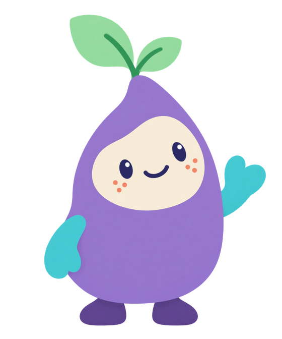
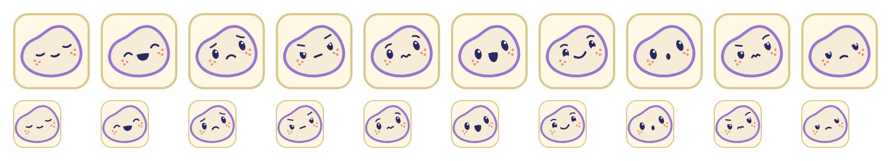
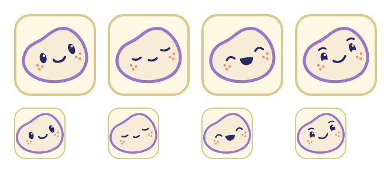
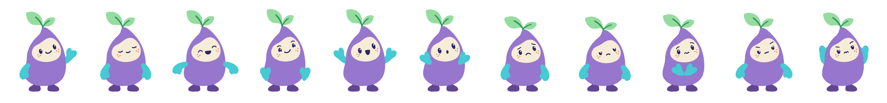

# Phase 1: the Nook character rig

Round 4, built by Opus 5.5 on 11 October 2026 for Fable's review and Jof's sign-off (brief decision J5). Local only:
nothing is deployed, nothing is wired into a game yet, and `nook-art.js` is not on the deploy allow-list (phase 2
adds it when a game uses it).

## What was built

| File | What it is |
|---|---|
| `public/fireworks/little-patterns/nook-art.js` | `window.NookArt` (and `module.exports` under Node): `svg(feeling, options)`, `face(feeling, options)`, `change(svgEl, feeling)`, `idle(svgEl)`, plus `FEELINGS`, `STATES`, `POSES`, `COLOURS`, `SHOULDER`, `STEM`, `BASE`. About 8.4 KB of markup per Nook. |
| `public/fireworks/little-patterns/nook.css` | Breath, blinks, expression-change transitions, the change squash and leaf follow-through, the wrapper keyframes for the games (hop, high hop, squash, grow, return, fade-in), and the Softer / reduced-motion rules. Documented at the top. |
| `tools/test-little-patterns-nook.cjs` | 15 tests (node:test). |
| `docs/little-patterns-round-4/build/character/` | The tracer, its output, the live sheet, the screenshot, comparison and benchmark scripts, and the evidence PNGs listed below. |

Options: `svg()` takes `decorative`, `className`, `label` and `grain`; `face()` takes `decorative`, `className`,
`label` and `ring` (`true` gives the neutral ring for Me, or pass a colour). The states are the ten feelings plus
`greet`; anything else falls back to calm.

## The traced stills

Hello over the original (the rig at 50% over `assets/nook.png`, both 560 by 672):



The ten face crops at the board's card size (about 70 px) and at 44 px, on the neutral card, no words. Order:
calm, happy, sad, angry, worried, excited, proud, surprised, frustrated, disappointed.



The four happy-side faces (hello, calm, happy, proud) at 70 and 44 px:



All eleven states at 132 px (greet, calm, happy, proud, excited, surprised, sad, disappointed, worried, angry,
frustrated):



And at 300 px, the performance size: [bodies-large.png](character/bodies-large.png). Expression changes, slowed ten
times, left to right: [change-frames.png](character/change-frames.png).

Open `character/sheet.html` in a browser to see all of this drawn live, with a Softer toggle, an opacity slider and
an outline view for the overlay, and buttons that change Nook's feeling in place and run the wrapper hops.

## How the original was traced

`character/trace-nook.py` (Python, OpenCV, Pillow) reads the identity master and writes `trace.json`:

1. Every opaque pixel is classified to the nearest of the profile's sampled colours (lavender, cream, navy, coral,
   turquoise, mint, stem green, purple, white glint). The segmentation is clean: one body, one patch, two eyes,
   one mouth, six freckles, two mittens, two leaves, one stem, two feet.
2. Each part's outline is found at sub-pixel accuracy: where the part meets transparency the PNG's own alpha is the
   edge; where it meets another colour, a lightly blurred class mask is. The field is upsampled four times and
   contoured at 50%.
3. Where the original hides part of an outline, the hidden run is dropped and bridged with a Hermite curve that
   continues the visible edge: the body behind the front mitten and the stem; the raised arm behind the body (plus a
   hidden wrist that reaches the shoulder, so the arm can swing); the feet under the body (redrawn as domes that
   continue both side edges, so a slump never shows a gap).
4. Each outline is fitted with cubic Beziers (Schneider's algorithm) at 0.5 to 0.7 px tolerance: the body is 15
   segments, the patch 9.
5. Eyes are fitted ellipses (left 25.5 by 38.3 px tilted -12 degrees at 250,335; right 24.2 by 40 px tilted -22
   degrees at 356,301), glints and freckles are measured circles, the original smile and the two leaf veins are
   centre lines with their measured widths.

The outlines in `nook-art.js` (body, patch, two feet, two leaves, three mittens) are the tracer's output, unedited
(a test checks this). The two veins are single cubics fitted through the tracer's vein centre points (within
0.4 px), and the eye, glint, freckle and smile values are its measurements. The tracer is deterministic: rerunning
it reproduces `trace.json`. `compare-overlay.py` renders nothing itself; it compares `rig-hello-560.png` (the rig's
greet pose, transparent) with the original, part by part:

| Part | Overlap (IoU) | Outline distance, median / 95th percentile / max |
|---|---|---|
| Whole silhouette | 0.996 | 0 / 1 / 5.4 px |
| Body (where neither picture has a mitten over it) | 0.994 | 0 / 1 / 8.8 px |
| Patch with its features | 0.985 | 0 / 1 / 3.2 px |
| Eyes and mouth | 0.892 | 0 / 1 / 1.4 px |
| Freckles | 0.978 | 0 / 0 / 1 px |
| Mittens | 0.986 | 0 / 1 / 1.4 px |
| Leaves and stem | 0.986 | 0 / 1 / 5 px |
| Feet | 0.985 | 0 / 1 / 5 px |

In pixels of the 560 by 672 master. `overlay-hello-diff.png` shows where the two differ (magenta: only the
original; green: only the rig). The departures are deliberate and small:

- **The body's left side just above the front mitten** (the 8.8 px maximum). In the original the outline turns
  slightly concave there, where the mitten covers it. Once the arm moves (happy, excited, surprised, worried) that
  showed as a dent, so the edge is redrawn convex from y 392 down behind the mitten. In the hello pose this is a
  sliver about 3 to 5 px wide beside the top of the mitten.
- **The stem base** is a short, slightly wider stroke so the two veins meet the crown as one stem, as in the
  original; it differs by a few pixels at the fork.
- **The smile** is a stroked centre line, 8.5 px wide with round ends, rather than the traced filled shape, so every
  mouth is drawn the same way.
- **The paper grain** is not reproduced by default (see Texture).

## The rig

Transform tree, as in the profile:

```text
position wrapper (the game's element)    placement; hop, squash, grow and return keyframes from nook.css
  svg.nook                               breathing only (scaleY 1.015 over 4 s, about the ground line)
    .nook-feet                           on the ground, never posed
    translate(285 602)                   the base of the body
      .nook-pose                         tilt and squash per feeling (inline CSS transform, 300 ms settle)
        .nook-squash                     the short squash when the expression changes
          stem base; two leaves          translate(266 143) > .nook-leaf (pose) > .nook-follow (follow-through)
          back arms                      the raised mitten, behind the body
          body, patch, six freckles      fixed
          .nook-features                 brows; two translate(eye) > .nook-lid (blinks); mouth
          front arms                     the resting mitten and the held-up hand
```

**One pivot convention.** Every pivot is a `translate()` wrapper whose origin is the pivot; the animated group
inside it has no transform attribute, only a CSS transform, so it turns about 0 0. Nothing in the markup uses
`rotate(a cx cy)` or `transform-origin`; `nook.css` pins `transform-box: view-box; transform-origin: 0 0` on the
SVG's groups so no other stylesheet can move the pivots. The only `transform-origin` in the system is on the outer
`svg.nook` (a normal CSS box: the breath grows from the ground line) and on the wrapper keyframes. A test enforces
this on every state.

**Pivots.** Shoulders at 161,415 (viewer-left) and 420,415, each about 22 px inside the body edge; the leaf joint
at 266,143 where the two veins meet; the body pose about 285,602, the bottom of the body; the eyes about their
anchors 250.3,335.3 and 355.7,301.

**Arms.** Each arm group carries `rotate(shoulder) translate(0, reach) rotate(wrist)` and its mitten shapes are
drawn about the hand's centre. A pose names a hand position (or a swing about the shoulder from the traced position)
and a hand turn; the module works out the three numbers, and CSS interpolates them, so a change swings the hand in
an arc about the shoulder. Rotation alone could not reach the sheet's poses with one shape, so there are three
fixed shapes, all traced:

| Shape | Source | Layer | Used by |
|---|---|---|---|
| rest | the original front mitten (thumb lobe low and inward) | in front of the body | hello (left), calm, happy (swung out 33 degrees), sad, angry (swung out 9), disappointed |
| raised | the original waving mitten, with its wrist hidden behind the body | behind the body | hello (right), excited (both), frustrated (both, swung 30 degrees towards the head) |
| hand | the waving mitten without the wrist, held up | in front of the body | surprised (beside the cheeks), worried (gathered below the patch), proud (at the outer hips) |

The other side is the mirror image about x 290.5. Each arm has a back and a front group with the same transform;
the shape that is not in use sits at opacity 0, so a change from a resting to a raised arm swings and cross-fades
(150 ms) rather than jumping between layers.

**Faces.** Discrete paths per feeling, never path animation (Safari 16 cannot animate `d`). The patch, eye anchors
and freckles never move.

| State | Eyes | Brows | Mouth |
|---|---|---|---|
| hello | the original open ovals with glints | none | the original smile |
| calm | softly closed lids, nearly flat | none | short shallow smile |
| happy | closed upward arches | none | broad open smile (filled) |
| excited | open, 12% larger | none | taller open smile |
| proud | open, glancing up, a smiling lower lid | two raised arcs | crooked smile, one corner higher, small dimple |
| surprised | open, 12% larger | none | small vertical O |
| sad | open | inner ends raised | clear down-curve |
| worried | open, glancing to one side | curved, inner ends raised | short wavy line |
| angry | narrowed, lid slanting down to the inside | inward and down | short firm line |
| frustrated | mild lid tension | uneven, knitted | small zigzag |
| disappointed | heavy, relaxed lids | none | short shallow down-curve |

**Body and leaves per feeling.** Lift (vertical scale about the base) 1.01 to 1.02 for happy, excited, proud and
surprised; .985 for worried, .99 for angry; sad .965 with a 1.5 degree lean, disappointed .955 with 2 degrees.
Leaves rise up to 6 degrees (excited, proud) and droop up to 12 (sad). All within the brief's limits (scale at most
1.06, rotation at most 6 degrees for the body). Every state stays inside the 560 by 672 frame (the screenshot script
measures each pose's extent).

## Motion (nook.css, and two small helpers in nook-art.js)

- `svg.nook`: the breath, nothing else. `.nook-still` pauses it.
- `NookArt.idle(svgEl)` schedules a blink every 3.5 to 7 s (close 70 ms, hold 50, open 90) with timers, never a
  requestAnimationFrame loop; it skips the closed-eye faces and any blink during a change; it rests after 45 s without
  a pointer or key press, and while the page is hidden, and returns `{ stop, poke }`.
- `NookArt.change(svgEl, feeling)` changes a rendered Nook in place: eyes close (80 ms), the features swap behind
  the blink, eyes open (120 ms); arms, leaves and posture settle (300 ms, the settle easing, about 4% overshoot); the
  body squashes to .97 and recovers (100 + 220 ms); the leaves follow 60 ms late with two damped swings of up to 3
  degrees. A newer change cancels a pending one. With Softer or reduced motion the swap is instant.
- Wrapper keyframes for phase 4: `.nook-hop` (8 px), `.nook-hop-high` (10 px), `.nook-squash-once` (.95),
  `.nook-grow` / `.nook-return` (from the frame position, set `--nook-dx`, `--nook-dy`, `--nook-s`), `.nook-fade-in`.
  There is no wrong-answer tilt (item 64) and no Add arrival here (item 60 puts it on Help).
- Softer and `prefers-reduced-motion: reduce` remove the breath, blinks, squashes, follow-through, hops, grow and
  every transform transition; the 150 ms mitten cross-fade stays.

## Texture

Built untextured first, with the profile's flat colours. The original's grain is very faint: measured on flat areas
of the master, its fine variation is about 1 level in 255 on the body and feet and 4 to 5 on the mittens and cream.
At 132 to 300 px tall it averages away to nothing visible.

A cheap grain was then added as an option (`svg(f, { grain: true })`): a 48-unit tiled `<pattern>` of faint light
and dark flecks laid over each coloured part, with a unique id per Nook, no filters. Measured with
`character/bench-texture.cjs` (headless Chrome, CPU slowed 6 times, device pixel ratio 2, Nook idle plus a change
every 400 ms, 5 s per run, four runs each):

| Case | First render (median) | Mean frame | Frames over 20 ms (per 5 s) |
|---|---|---|---|
| 1 Nook at 300 px, untextured | 38 ms | 17.5 ms | 8 |
| 1 Nook at 300 px, grain | 43 ms | 18.3 ms | 16 |
| 3 Nooks at 200 px, untextured | 53 ms | 25.8 ms | 52 |
| 3 Nooks at 200 px, grain | 100 ms | 21.7 ms | 41 |

Frame times move within the run-to-run noise (the three-Nook grain runs even came out faster), but the grain
doubles each Nook's markup (8.4 to 17 KB), roughly doubles first render for several Nooks, and doubled the long
frames for the single large Nook. It is not "nothing measurable", and it buys nothing visible at game sizes.
**Decision: untextured by default; the grain option stays for the iPad test. Final decision deferred to the iPad 5
measurement** (item 54), with `character/texture-bench.html`, which runs the same cases and shows the table on
screen.

A second finding matters more than texture: an expression change repaints the SVG for the 300 to 660 ms of its
transitions. One Nook changing is fine (about 17.5 ms frames even at 6 times slower); twelve changing at once is
not (about 135 ms frames at 6 times slower, so roughly 22 ms on this PC unthrottled). Idle costs nothing (twelve breathing,
blinking Nooks held 16.7 ms frames). So the games should change one rig at a time, and the Feelings board should
use the static `face()` crops, as planned.

## Tests

- `node --test tools/test-little-patterns-nook.cjs`: **15 pass**. Every state renders well-formed SVG with its
  `data-feeling`; accessible names (labelled image, decorative, escaped labels); the face crop is the patch path
  with a rim, the same features and no body; transform tree (breath only on `svg.nook`, feet outside the pose, the
  squash inside the pose, follow-through inside each leaf, two lids); one pivot convention on every state, with and
  without grain; the canonical geometry is identical in every state (body, patch, six freckles, two feet, two fixed
  leaf shapes, one visible mitten per arm); every state has its own eyes and mouth, the four happy-side faces differ
  by eyes and by mouth, and sad/disappointed, angry/frustrated, happy/excited differ by both; palette only; no
  front mitten covers the patch (and so the eyes or mouth) in any state, a check that fails if a hand is moved
  onto the face; `change()` in jsdom (instant under reduced motion and Softer; behind a blink otherwise; a newer change
  wins); `idle()` rests when hidden and stops cleanly; the CSS limits and reduced-motion rules; the grain option;
  the shipped geometry equals `trace.json`.
- The existing suites: `node --test tools/test-little-patterns.cjs tools/test-little-patterns-ui.cjs
  tools/test-little-patterns-voice.cjs tools/test-little-patterns-feelings.cjs tools/test-little-patterns-nook.cjs`:
  **143 pass, 0 fail** (the 128 from before plus the 15 new ones). No game file changed.
- `node tools/stage-little-patterns.cjs --check`: passes (322 runtime files; `nook-art.js` and `nook.css` are not on
  the allow-list yet, by design).

## Evidence in `character/`

| File | What |
|---|---|
| `overlay-hello.png` | Hello at 560 by 672 over the original, rig at 50% |
| `overlay-hello-diff.png`, `overlay-hello-metrics.json` | Where the rig and the original differ, and the table above |
| `rig-hello-560.png` | The rig's hello alone on transparency (input to the comparison) |
| `faces.png` | The ten face crops at 70 px and at 44 px, 2x |
| `faces-happy-side.png` | Hello, calm, happy and proud faces at 70 and 44 px, 2x |
| `bodies-132.png` | All eleven states at 132 px, 2x |
| `bodies-large.png` | All eleven at 300 px |
| `change-frames.png` | Five expression changes, seven frames each, CSS slowed 10 times |
| `sheet.html` | Everything above, drawn live, with Softer, the overlay slider, live changes and wrapper hops |
| `trace-nook.py`, `trace.json` | The tracer and its output |
| `shoot-character.cjs`, `shoot-transitions.cjs`, `compare-overlay.py` | Regenerate the PNGs and metrics |
| `texture-bench.html`, `bench-texture.cjs` | The texture benchmark (page and headless driver) |

Regenerate with `node docs/little-patterns-round-4/build/character/shoot-character.cjs`, then
`python docs/little-patterns-round-4/build/character/compare-overlay.py` and
`node docs/little-patterns-round-4/build/character/shoot-transitions.cjs`. Screenshots were taken with
`prefers-reduced-motion: no-preference` emulated and the breath stopped, so stills are not caught mid-breath.

## Where the rig departs from the sheet

The faces follow the sheet closely. The bodies follow it with the original's short mittens, so a few poses are the
nearest honest version rather than a copy:

- **Proud**: the sheet's hands-on-hips is drawn as the held-up hand placed at each outer hip, tipped outwards. With
  no elbows it reads as hands at the hips, but it is not a bent arm.
- **Frustrated**: the raised mittens sit behind the body beside the head, so part of each hand is hidden by the body
  edge; the sheet shows them a little higher and fully in view. Bringing them in front would cross the face.
- **Worried**: the two held-up hands meet below the patch, tipped outwards; they read as hands held together rather
  than the sheet's softer clasp.
- **Happy**: the arms swing out 33 degrees, a little less than the sheet, to keep the hand inside the 560 by 672
  frame.
- **Hello's left body edge** is the convex redraw described above.

## Open points

1. **Safari 16 and the iPad 5 are untested.** Chrome renders and animates everything here. To check on the iPad:
   CSS transforms and transitions on SVG groups inside translate wrappers, `transform-box: view-box`, `innerHTML` on
   an SVG group (the face swap), and `var()` inside `@keyframes` (`.nook-grow`; if Safari ignores it, phase 4 can run
   the grow with a transition or the Web Animations API instead).
2. **The texture decision needs the iPad.** `texture-bench.html` and `sheet.html` live under `docs/`, which
   `tools/serve-fireworks.cjs` does not serve. Serving the repository root over Wi-Fi would also expose
   `.wrangler/voice-build/.env` (the voice API key), so please don't. Phase 2 or 6 could add a read-only route to
   `serve-fireworks.cjs` for this one folder, or copy the two pages into a temporary served folder for the test.
3. **For phase 4**: change one rig at a time; keep the Feelings board on `face()` crops; Me uses
   `face(f, { ring: true })` (neutral ring `#8C8A99`; the colour is a proposal).
4. **Jof's look at the stills (J5)**: the proud, frustrated and worried arms above are the ones most worth his eye.

Commit: PENDING
