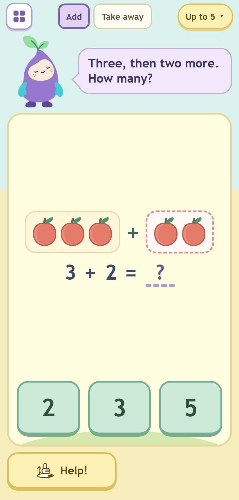
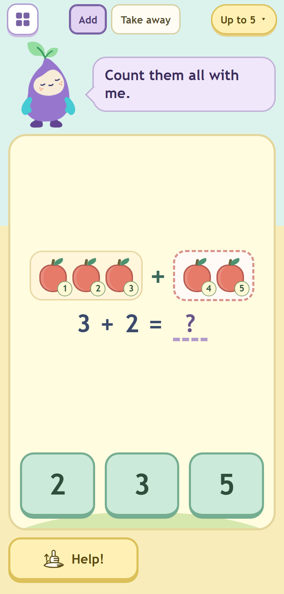
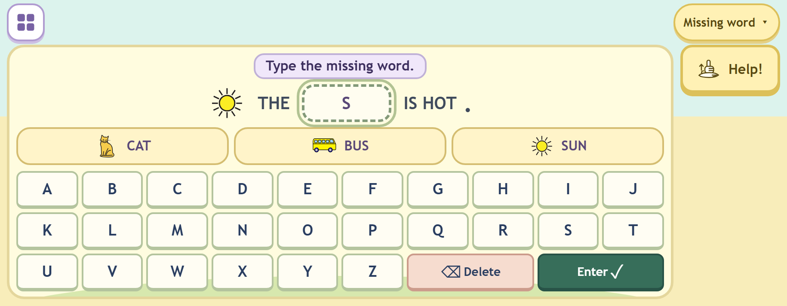

# Phase 2: the Nook frame, the shelf, the Grown-ups hold, the manifest and the Garden in the frame

Round 4, built by Opus 5.5 on 11 October 2026 for Fable's review. Local only: nothing deployed or pushed. Feelings
(phase 4), the real Shapes game (phase 3) and the voice clips (phase 5) are untouched; Blocks is unchanged.

## What a child sees now

- **The shelf** (`index.html`): Nook greeting ("Hello! I’m Nook. Let’s play.", tap the bubble to hear it), eight tile
  buttons (Count, Add, Words, Patterns, Shapes, Feelings, Paint, Blocks), and in the foot only the Grown-ups gear.
  No links, no sound button, no player button.
- **A game** (`garden.html`): the shelf button, Add / Take away chips (Add only), one level pill; Nook with one bubble
  (a button: tap to hear the line again); the task card with the picture centred and the answers in a fixed bottom
  row; Help on the left, Next on the right only after success, Again small on the left after success.
- **The shelf button or Android Back** opens the same shelf full height over the game, with the current game marked.
  Count, Add, Words and Patterns switch in place; the others navigate; the current tile closes it.
- **Grown-ups** opens only after a two-second press and hold (a ring fills from 300 ms). It holds player switching,
  Settings (now with Sound and Word pictures), privacy and credits, the content pages and the K-Pop BOOM! door.
  While a grown-up has sound off, a small crossed speaker shows on the shelf. Nothing on a play screen mutes.

Selected evidence (all 72 are listed below): [phone-shelf](phase-2/phone-shelf.png),
[small-gate-hold](phase-2/small-gate-hold.png), [phone-shelf-over-count](phase-2/phone-shelf-over-count.png),
[phone-add-help](phase-2/phone-add-help.png), [phone-add-done](phase-2/phone-add-done.png),
[phone-add-bridge-help](phase-2/phone-add-bridge-help.png), [small-words](phase-2/small-words.png),
[land-words](phase-2/land-words.png), [ipad-add-bridge-help](phase-2/ipad-add-bridge-help.png).

## What changed, file by file

All under `public/fireworks/little-patterns/` unless noted.

| File | Change |
|---|---|
| `frame.css` (new) | The frame for every game: tokens, play-screen guards (no selection, no long-press callout, no pull-to-refresh, zoom left on), top bar, Nook column and bubble, task card (scrolls only when the viewport is too small), the shared answer buttons (96 px tall, chosen green with a tick, others faded), the two-slot action bar 20 px clear of the bottom, the three layouts, Nook's tap wiggle, the shelf and overlay, the Grown-ups ring and sheet list, Softer and reduced motion. Built from `mockups/frame.css`. |
| `frame.js` (new) | `window.LPFrame`: the frame height follows the visual viewport (`--app-h`); no context menu outside inputs and dialogs; `bubble()` (say, flash, hear again from bundled clips only, speaker shown only when the line has clips); `nook()` (places the phase-1 rig in its `.nook-pos` wrapper, starts idle blinks, `celebrate(feeling)` = expression change then one 8 px hop on the wrapper, `rest()`, three calm tap responses); `fit()` and `onResize()`. Shapes and Feelings can use it as is. |
| `shelf.js` (new) | `window.LPShelf`: the shelf markup (tiles are buttons), `mountHub`, `mountOverlay` (in-game overlay, current tile marked, Garden tiles switch through `onMode`, others navigate, one history entry for Android back), the hold gate, the Grown-ups sheet and the privacy-and-credits sheet, the sound badge. `navigate()` is replaceable for tests. |
| `hub.js` (new) | Mounts the shelf on the hub page. |
| `icons.js` (new) | The mockup icons as a runtime module (`window.LPIcons`). |
| `index.html` | Rewritten as the shelf. The old hub's player button, privacy text and BOOM card moved into Grown-ups. |
| `garden.html` | Rewritten as the frame. Kept ids: `#support` (the pill), `#speech` (the bubble's text), `#activity-title`, `#instruction`, `#status` (visually hidden), `#task`, `#help`, `#next`, `#repeat`. New: `#shelf-open`, `#modes`, `#nook`, `#bubble`. Gone: hero, tabs row, brand, footer, scene label, sound toggle, Grown-ups and player buttons, `#next-level`, `#level-strip`, the name tag. |
| `garden.js` | Assembled from the committed file: round generators, save/restore, the chooser, drag, keyboard handling, counting and Help logic carried over line for line; new header/bubble, pill, action bar, Add picture, ten-frames, Nook reactions, fitting and the shelf hookup. Details below. |
| `garden.css` (new) | The Garden's objects inside the frame: apples, five- and ten-frames, trays and rows of ten, the Add picture, the missing-part picture, take away (the crossing-out copied exactly), patterns, words, keys, keypad, the chooser, and `fit-1`/`fit-2`/`fit-3` reductions. Replaces `garden-preview.css` + `garden-live.css` for the game. |
| `garden-live.css`, `home.css` | Deleted: nothing loads them now. `garden-preview.css` stays on disk because the unshipped `workshop-preview-*.html` pages use it; it is no longer on the deploy list. |
| `shared.js` | The Sound setting: a device-wide Grown-ups setting (`lp-sound`, default on). While off, every page starts muted and no tap unmutes it. `LP.setSound`, `LP.soundOff`, `LP.settings`, `LP.audio.has()` added; `LP.audio` otherwise unchanged. Settings form: Sound first, Word pictures after the keyboard, the sound sentence reworded ("spoken only while it is on" kept). |
| `learning.js` | Additive: `wordPictures: 'show'` in `defaults`, `'show' | 'hide'` in `normalisePrefs`. |
| `shapes.html`, `shapes-stub.js` (new) | A frame page saying "Shapes are coming soon." and "Coming in phase 3", with the shelf overlay. Phase 3 replaces both. |
| `manifest.webmanifest`, `assets/icon-192.png`, `assets/icon-512.png` (new) | Name "Little Patterns: Nook's games", short name "Nook", `start_url`/`scope` `./`, standalone, cream background, sky theme; Nook on cream made from `nook.png` with Pillow. Linked from the shelf, Garden and Shapes, with `apple-touch-icon`. No service worker. |
| `studio-lab.html` | `#home` goes to `./` (the shelf), labelled "Back to Nook's games". `blocks.html` already linked its header and footer to `./`, so it is unchanged. |
| `tools/stage-little-patterns.cjs` | Adds the 13 new runtime files; drops `home.css`, `garden-preview.css`, `garden-live.css`. `--check` passes (332 files). |
| `tools/test-little-patterns-ui.cjs` | Rewritten against the frame (below). |
| `tools/test-little-patterns-layout.cjs` (new) | The layout harness (below). |

## The frame in detail

- **Layouts.** Phone portrait: 56 px top bar, Nook (112 x 134) beside the bubble, the card, the 92 px action bar.
  Phone landscape under 520 px tall: 124 px Nook column, the card, a 124 px action column (Help or Again at the top,
  Next at the bottom, 20 px clear); Words hides the Nook column and shows the bubble's line at the top of the card.
  Tablet from 760 px wide and 521 px tall: Nook 190 x 228 with the bubble above it beside the card. The page never
  scrolls; when a device keyboard or large text shrinks the viewport the card scrolls inside the frame
  (`interactive-widget=resizes-content` for Android, `visualViewport` for iOS).
- **Fitting.** After each render and viewport change, `garden.js` tries the picture side by side and stacked, each
  at full size then three smaller steps (`fit-1..3`), and keeps the arrangement that needs least shrinking (side by
  side wins a near tie, so 3 + 2 stays on one line at 360 px). Groups over five are rows of five. Tap targets never
  shrink below 44 px.
- **Bubble.** Shows the line from round state: success line, else the kind retry line, else the Help line, else the
  prompt. Tap hears it again from bundled clips while sound is on; no device voice. The speaker glyph shows only
  when the line has clips (success and retry lines today; see open point 1).
- **Answers.** Stay in their row after success: the chosen one green with a tick, the others faded, all disabled.
  The chosen digit fills the "?" (fading up 12 px once); no separate total. Keys and the keypad rest (disabled)
  under a finished answer until Again or Next, so the card never changes height or content shape on success.
- **Nook.** Calm at rest. Wrong answer: only the bubble changes. Success: Nook changes to happy, proud or excited
  (fixed per round id), then one 8 px hop on the wrapper; the next round is calm again. A tap gives, in turn: "Nook
  feels calm." in the bubble (the clip plays once phase 5 renders "Nook feels {x}."), a small wiggle (skipped for
  Softer / reduced motion in favour of the first response), and "Hello! I’m Nook. Let’s play." with its clip and a
  blink (calm's closed eyes get the leaves' follow-through instead). Only the frame Nook ever changes expression.
- **Gate.** 2,000 ms in all, ring from 300 ms (SVG stroke, linear fill, 250 ms drain), cancelled by release, a move
  over 10 px, pointer cancel, lost capture, page hide or visibility change; Enter or Space held is the keyboard way
  (key repeat ignored); a plain tap does nothing; focus returns to the gear when the sheet, or any dialog it opened,
  closes.
- **Android back.** One `pushState` entry, pushed once at the first touch or key press (Chrome's back button skips
  entries a page adds before any user gesture, so pushing at load would not work on the S24). Back opens the shelf
  overlay; a second back leaves as usual. Mode switches use `replaceState` for the hash, never a new entry.

## The Garden in the frame

- **Count**: objects unchanged (frames, trays, rows of ten, counting taps, running totals, keypad). Bubble "How many
  apples?", "Count with me." once counting starts. Help still counts one more each tap, then outlines the answer.
- **Add**: one augmentation picture. Levels 1 and 2 and the Doubles / Make ten sets: first group, "+", second group
  in a dashed outline, equation, three answers; prompt "Three, then two more. How many?". Help step 1 numbers every
  apple 1 to n across both groups and the second group's apples drop in (12 px, staggered, the only Add motion);
  step 2 outlines the answer. Level 3 (inside twenty): two ten-frames, a full ten then the first part's ones and the
  apples that came (each with a dashed ring); Help puts 10 on the full frame and counts on. Level 4 (over ten): the
  first part in its frame, the second in a dashed frame; Help ("Fill the ten first.") moves apples across with their
  dashed rings, puts 10 on the full frame and numbers the rest 11 onwards. Level 5: the rows of ten (approved) in the
  same two-group picture, Help counting in tens. Level 6: the approved missing-part picture, kept. Take away: the
  approved one-group crossing-out, CSS copied exactly, now five to a row. Keypad and demo modes, doubles, make ten
  and the zero cases are kept.
- **Words**: Missing word shows its three picture cards from the start (`wordPictures`, default show); card picture
  and word are centred together (picture above the word on phones, beside it in landscape and on tablets). Help with
  pictures shown: step 1 outlines the sentence picture, step 2 outlines the card; with pictures hidden, step 1 shows
  them in their reserved places (round-3 behaviour). Keys in ABC order end in Delete then Enter; no Clear. Under 460
  px wide (all phones in portrait; item 61 said under 400, but nine columns cannot reach 44 px at 412) the keys are 7
  to a row: A–G, H–N, O–U, V–Z + Delete + Enter, each at least 44 x 44 (52 px tall on tall phones); landscape and
  tablet are 10 x 3 with U–Z, Delete and Enter. Number words puts Space before Delete and Enter (a full-width bar on
  phones). The device-keyboard preference shows only Delete and Enter. Missing letter, Word order (drag with tap
  fallback) and Number words come from the pill, as before.
- **Patterns**: the three families as approved; the pill shows the family's beads and "2 shapes"; the chooser holds
  the families, "Make your own string" and the fourteen numbered levels. No tab row on the play screen.
- **The pill** (`#support`) opens the existing chooser. Labels: Count "1–5" ... "51–100"; Add "Up to 5", "Up to 10",
  "Up to 20", "Over ten", "Tens", "Missing part"; Take away "Up to 5" ... "Back over ten", "Tens"; sets "Doubles" /
  "Make ten" (the place in the set is in the accessible name); Patterns "2 shapes" or "Level 7 · Growing"; "Make your
  own"; Words "Missing word", "Missing letter", "Word order", "Number words · 1–5".

## Migration rules (saved state)

No migration flag was needed: `garden-position` keeps the same fields (`mode, wordTab, indices, selection, levels,
operation, patternMode, patternFamily, strip:1, spell:1`) and `garden-rounds` the same round objects and ids.
`restore()` is unchanged apart from resetting Nook's celebration marker, so every older rule still applies (the
shared range and pattern index from round 2, the one-time level reset when the strip arrived, Number words' one-time
move to spelling, ids or content matching). `patternMode: 'make'` now simply opens on Make your own (chosen from the
pill). A saved sentence `hint: 1` now means "sentence picture outlined" with pictures shown, or "pictures shown"
with them hidden. Players, drafts, settings, levels and positions all survive; a test seeds a full round-3 save and
checks each.

## Tests

| Suite | Before | After |
|---|---|---|
| `test-little-patterns.cjs` (logic) | 41 | 41 (unchanged; learning.js changes are additive) |
| `test-little-patterns-ui.cjs` | 63 | 74 |
| `test-little-patterns-voice.cjs` | 3 | 3 |
| `test-little-patterns-feelings.cjs` | 21 | 21 |
| `test-little-patterns-nook.cjs` | 15 | 15 |
| **Total** | **143 pass** | **154 pass, 0 fail** |
| `test-little-patterns-layout.cjs` (new, Chrome) | – | 6 pass (31 scenarios x 6 viewports) |

`node tools/stage-little-patterns.cjs --check`: passes, 332 runtime files.

The 63 UI tests are all kept and rewritten where the chrome changed, intents unchanged: the Sound toggle became the
Grown-ups Sound setting (`LP.setSound`), the player button became `LP.choosePlayer()` (the real path through the
hold is tested separately), the level strip became the pill's chooser, Clear became Delete, the go-row became the
action bar, `.sum-result` totals became the filled "?", and the pill texts changed. Deliberate behaviour changes in
those tests: the default "Apples for our picnic!" prompt is now "How many apples?"; a finished typed answer is
locked until Again or Next (it used to be editable, which is what produced "stale success"); a finished sentence
keeps its keys, disabled.

New tests (11): the frame's structure and the absence of the old chrome, links and mute controls; hear-again on the
bubble (silent prompt, retry line, success chain, Grown-ups mute); the hold gate with Node's mock timers (300 ms
ring, 2,000 ms open, release, 12 px move, pointer cancel, page hide, short key press, held Space with key repeat,
focus back after the sheet, Settings and the player chooser); the shelf overlay (current tile, in-place switching,
the hash, navigation, Escape, focus back, one history entry at the first touch, popstate opens it, no keys reach the
game behind it, the sound badge); the hub (eight tile buttons, no links, foot, greeting clip, navigation, badge on
and off across visits); the word-pictures setting; Add's one picture and its two Help steps with the arrival only on
Help, rows of five, demo mode; Nook's reactions (calm through a mistake, a happy-side feeling and one hop on success,
calm for the next round, the three tap responses in turn, nothing in the puzzle changed); a full round-3 save
restoring; the key order and rows; the Shapes stub, Paint's home, the manifest, the icons and the deploy list.

The gate test found a real bug while being written: `isOpen` was copied by `Object.assign` as a value, so keys
reached the game behind the shelf. Fixed with `Object.defineProperties`.

## The layout harness

`node --test tools/test-little-patterns-layout.cjs` starts `serve-fireworks.cjs` and headless Chrome on free ports
(profile in the OS temp folder, both killed afterwards), seeds state from the hub page, and checks at 412 x 860,
360 x 740, 915 x 356, 740 x 360, 1024 x 698 and 1280 x 800: page overflow, the card scrolling or anything outside
it, truncated chip / pill / answer / tile / key / card / action labels, any answer, card, bubble or action over Nook,
and every visible button, link or input under 44 x 44. It skips with a message when Chrome is missing
(`CHROME_PATH` overrides). `LP_SHOTS=<dir>` writes the evidence screenshots; `LP_ONLY` and `LP_VIEWPORTS` narrow a
run. About 3.7 minutes for the full run.

31 scenarios: shelf, the hold mid-ring, the Grown-ups sheet, the overlay; Count (and Help), Count 100, Count 73 with
the keypad; Add 3 + 2 (play, Help, done), 6 + 4, 8 + 7 (and Help), 12 + 5 Help, 60 + 30 Help, missing part,
keypad; Take away 6 − 2 and 70 − 30; Missing word, Missing letter, Word order, Number words 100 typing, the device
keyboard; Patterns (2 and 4 shapes, level 10, mirror) and Make your own; the Shapes stub. **Result: all pass at all
six viewports.** The first runs found and I fixed: a button reset that outranked every component style, 39 px keys
at 360 px, the Number-words tray running under the keys, sticks picking up group apple sizes, tens and take-away
rows too tall in landscape, Make's narrow answers, squeezed chips, and the folded Words line being a sub-44 px
button.

## Screenshots (`docs/little-patterns-round-4/build/phase-2/`)

72 PNGs, `<viewport>-<screen>.png`, viewports `phone` (412 x 860), `small` (360 x 740), `land` (915 x 356), `land2`
(740 x 360), `ipad` (1024 x 698), `desk` (1280 x 800); screens `shelf`, `gate-hold`, `shelf-over-count`, `count`,
`add`, `add-help`, `add-done`, `add-bridge`, `add-bridge-help`, `take`, `words` (portrait on phone/small/ipad/desk,
landscape on land/land2), `patterns`. Taken with `prefers-reduced-motion: no-preference`; I looked at every one.

## Judgement calls

1. **Restructured CSS** rather than overriding `garden-live.css`: the old file sized objects by width breakpoints
   around a different page, and the frame needs height-aware fitting. Object looks were carried over; the take-away
   crossing-out is a verbatim copy.
2. **Landscape answers are 76 px tall**, not 96: at 356 px tall the card is 290 px and the pictures need the rest.
   Portrait and tablet keep 96 to 104 px.
3. **Sound is a device-wide Grown-ups setting that persists** (so the shelf badge means something after a page
   change). It starts on; a tap never undoes a grown-up's off. Blocks' and Feelings' own Sound buttons still toggle
   for that page only, as before (Feelings loses its button in phase 4).
4. **Seven key columns on every portrait phone** (item 61 said under 400 px; at 412 nine columns are 39 px).
5. **Level 3 uses a full ten plus a second frame** holding the first part's ones and the new apples (dashed rings),
   because 12 + 5 cannot be shown as "first part in one frame, added part in the other".
6. **Level 5 uses the two-group picture with rows of ten**; the approved part is the rows of ten, the three-picture
   layout was the problem the round set out to fix.
7. **The folded Words line in landscape is text, not a button**: a 44 px button there would not fit with the cards and
   three rows of keys. Its hear-again is lost only in that layout (and prompts have no clips yet anyway).
8. **History entry at the first gesture**, not at load (Chrome would skip it).
9. **Finished answers lock** until Again or Next (keys, keypad and the Number-words box).

## Open points (decisions)

1. **Most prompt and Help lines have no clips**, so hear-again is silent for them (speaker hidden): "How many
   apples?", "{Three}, then {two} more. How many?", "How many more came?", "Nook eats {two}. How many are left?",
   "Type the missing word.", "Tap the missing letter.", "Drag the words, first to last.", "Type / Choose / Read the
   number word.", "What comes next?", "Which bead is missing?", the three rule prompts, "Make a bead string!",
   "What a string!", "What shall we play?", and the Help lines "Count with me.", "Count them all with me.", "Count the
   tens with me.", "Count the apples that are left.", "Count the new apples with me.", "Look for the part that
   repeats.", "Each group has one more.", "It turns around.", "Count on." Only "Fill the ten first." and "Nook feels
   {x}." are in the planned 50. Adding the rest (about 25 fixed lines, plus the composed Add prompt) would be phase-5
   scope and budget: Fable / Jof to decide.
2. **Add level 4 distractors** come from `learning.js` (`options()` walks the 1–20 pool), so 8 + 7 offers 1, 2 and 15.
   Learning logic was out of scope here; a one-line change to offer neighbours (14, 15, 16) is worth a decision.
3. **Extreme states fit by shrinking**: Add 60 + 30 on a 360 px phone draws its rows of ten with 7 px apples. Legible
   as rows, but small; a two-column row layout for big tens would be the alternative.
4. **Device pass outstanding** (S24 and iPad 5, both orientations): Safari 16 for `inert`, `:where()`, `dvh`,
   `aspect-ratio`, the gate's pointer capture, and the keyboard / `visualViewport` behaviour of item 62, which
   headless Chrome cannot show.
5. **Feelings still has its own Back and Sound** and links to `garden.html` (phase 4). Nook's per-game pay-offs
   (munching in Take away, the bead string) are phase 4.
6. **Suite command**: BUILDER-NOTES' test line could add `test-little-patterns-nook.cjs` and run the layout harness
   separately (it needs Chrome and takes about four minutes).

Commit: recorded in the follow-up commit.
