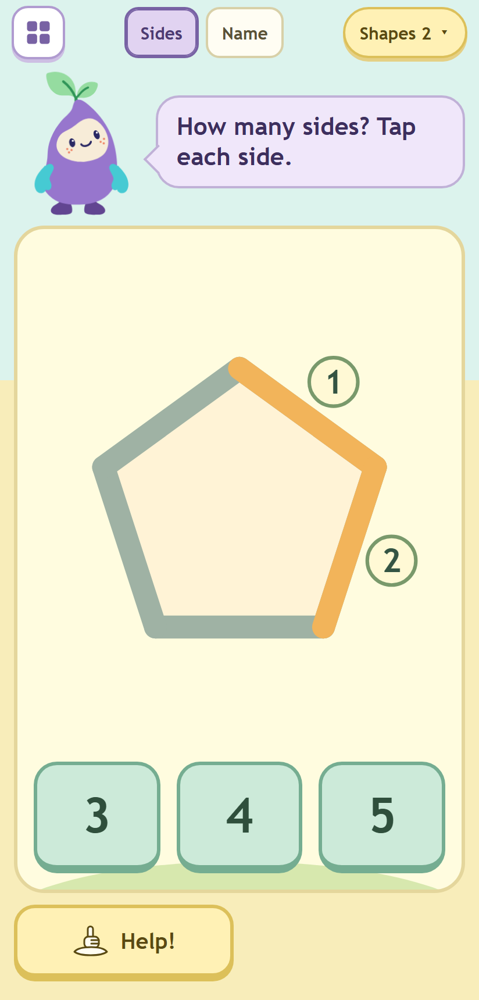
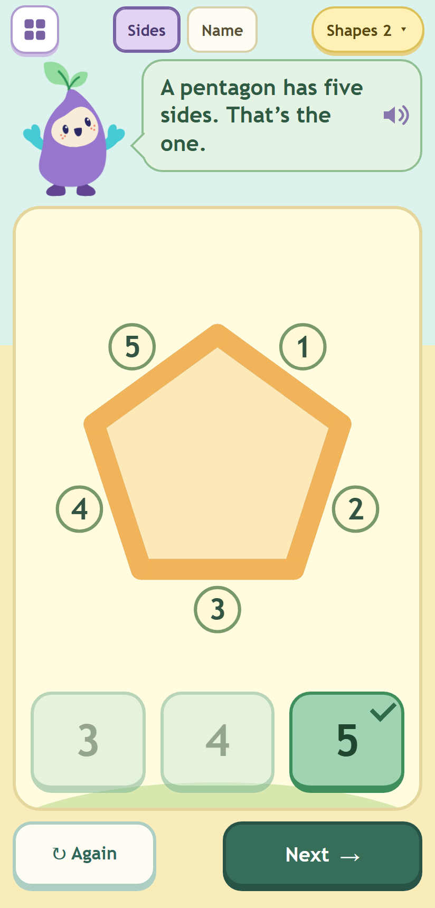
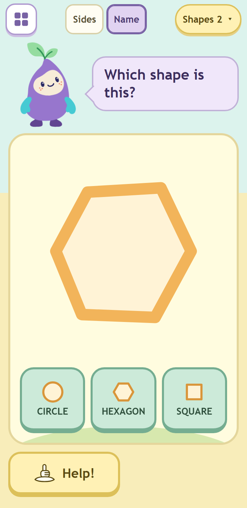
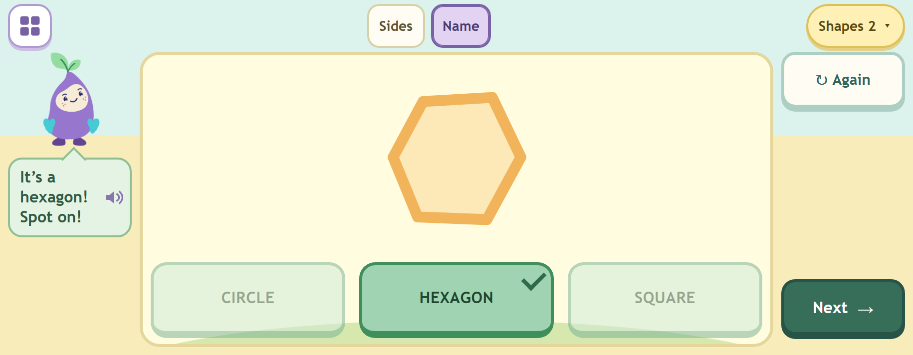
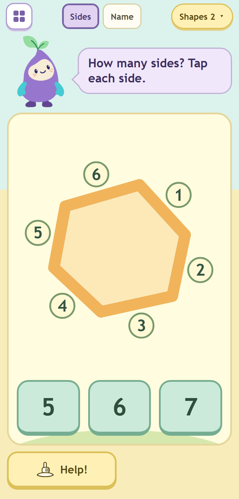

# Phase 3: Shapes

Round 4, built by Opus 5.5 on 11 October 2026 for Fable's review. Local only: nothing deployed or pushed. Feelings,
the voice clips and Blocks are untouched. Also in this phase, the two Garden fixes carried from the phase-2 review:
near distractors for Add and Take away levels 1 to 4, and Nook's new resting look.

## What a child sees now

- **Shapes** (`shapes.html`, the shelf's Shapes tile): the frame with two chips, **Sides** and **Name**, and one
  level pill, **Shapes 1** or **Shapes 2**, which opens the level chooser. Nook rests beside one bubble.
- **Sides**: one polygon drawn large, three number answers in the bottom row from the start (a child who knows can
  answer at once), Help on the left. A tap near a side lights it amber from corner to corner and puts a number on
  it, in the order the child tapped, and Nook says the number (the existing number clips). A tap on a side already
  counted only bumps its number, silently; it is never counted twice. With every side lit the shape warms.
- **Name**: one shape (circles and ovals too, in Name only) and three word answers, words only. Help shows a small
  picture of each shape beside its word, then outlines the answer.
- **Right answer**: it turns green with a tick, the other two fade, all three lock; Nook changes to excited or proud
  (fixed per puzzle) and hops once (8 px, on the wrapper); the bubble says the success line, for example "A
  pentagon has five sides. That’s the one." or "Spot on! It’s a square!"; the shape warms, and in Sides every side
  shows its number. Again (small, left) and Next (right) replace Help.
- **Wrong answer**: only the bubble changes, to one of the kind retry lines, said from its clip. Nook does not move.






## What changed, file by file

All under `public/fireworks/little-patterns/` unless noted.

| File | Change |
|---|---|
| `learning.js` | Shapes rounds (below), `LEVELS.shapes = 2` (additive), the pure hit maths `nearestSide` and tag placement `sideTag`, `SHAPES_SPEECH`, `successLine('shapes', round)`, and the Add / Take away near distractors. `spokenBank()` is unchanged. |
| `shapes.html` | Rewritten from the phase-2 stub: the frame with `#modes`, `#support`, `#nook`, `#bubble`, `#task`, `#help`, `#repeat`, `#next`, `#status`, the sr-only `#activity-title` and `#instruction`. |
| `shapes.js` (new) | The game: drawing, the pointer path, counting, Help, answers, success, retry, Again and Next, the level chooser, save and restore, the shelf overlay. `window.LPShapes` exposes `toUser`, `tapAt`, `nextSide` for tests. |
| `shapes.css` (new) | The stage and SVG, side, tag and fill styles and motion, word answers with their Help pictures, the chooser, Softer and reduced motion. |
| `shapes-stub.js` | Deleted (git rm). |
| `nook-art.js` | New `rest` state: the hello face (open eyes with glints, the original smile, no brows) with both arms down (the traced resting mitten on both sides, mirrored), upright, leaves level. Accessible name "Nook smiles". `STATES` now ends `greet, rest`. |
| `frame.js` | `nook()` rests in `rest` unless a game names another state; `rest()` returns to it. A tap on a resting (or greeting) Nook names its feeling as happy ("Nook feels happy."). |
| `garden.js` | Nook rests in `rest` (two lines). |
| `tools/stage-little-patterns.cjs` | `shapes.js`, `shapes.css` added; `shapes-stub.js` removed. `--check` passes (333 runtime files). |
| `tools/test-little-patterns-shapes.cjs` (new) | 22 tests (below). |
| `tools/test-little-patterns-layout.cjs` | 15 Shapes scenarios replace the stub scenario; taps go through the real pointer path. |
| `tools/test-little-patterns*.cjs` | Updated where the rest state, `LEVELS` and the stub changed; one new Add test; one new rig test. |

## The rounds (`learning.js`)

- **Catalogue** (`SHAPE_CATALOGUE`): every polygon is a point list in the 240 x 240 box, centred on its bounding box,
  listed clockwise on screen from its top corner (so "side 1" is always the first side clockwise from the top and
  Help goes round the same way). Circles and ovals are a centre, two radii and a turn.
  - Triangles (5): equilateral pointing up, pointing down, tilted 17 degrees; right-angled; long and thin.
  - Squares (5): upright, turned 15, 30 and 45 degrees, and a small upright one. No "diamond" anywhere.
  - Rectangles (5): wide, tall, tilted 20 degrees, long and thin at -35 degrees, standing and turned 12 degrees; all
    at least 1.6 times longer than wide, so a rectangle never looks like a square.
  - Circles (3): three sizes. Ovals (3): wide, tall, turned -30 degrees, all at least 1.6 to 1.
  - Pentagons (6, level 2): regular upright, pointing down, turned 14 degrees; the mock's uneven one, a house, a
    wide uneven one.
  - Hexagons (6, level 2): regular flat-top, pointy-top, turned 14 degrees; the mock's uneven one, a long one, a
    slanted uneven one.
  - All convex, every side at least 60 units (about 50 CSS px on the smallest landscape), no corner under 25 degrees.
- **Levels**: level 1 Sides = triangles, squares, rectangles (15 rounds); level 1 Name adds circles and ovals (21);
  level 2 keeps all of them and adds pentagons and hexagons (Sides 27, Name 33).
- **Order** (`shapeSequence`): fixed and mixed. Each shape's examples keep their `mixed()` order and are dealt from
  a seeded sequence weighted by what is left, so the same shape never comes twice running and the names do not
  cycle. The first round is the plainest new shape: an upright triangle at level 1, an upright pentagon at level 2.
  (Plain `mixed()` over the whole list gave runs of five triangles; see judgement call 2.)
- **Sides answers**: the side count and two near neighbours (within three, inside 3 to 8, never twice the same),
  smallest first; which neighbours is fixed per puzzle id, so the answer sits first, middle or last.
- **Name answers**: the name and two other names from the level. SQUARE and RECTANGLE are never on offer together;
  at level 1 CIRCLE and OVAL never are; at level 2 an oval and a circle may meet. Order fixed per puzzle id.
- **Ids**: `shapes:v2:L<level>:<mode>:<shape>#<variant>`, for example `shapes:v2:L2:sides:pentagon#house`.
- **Success line**: `successLine('shapes', round)` returns the text always ("A hexagon has six sides." / "It’s an
  oval!" with the usual opener, before or after, fixed per puzzle) and speaks a part only when it is in the spoken
  bank (`voiced()`), so today only the opener plays, exactly as custom words behave. When phase 5 merges
  `SHAPES_SPEECH` into `spokenBank()`, the facts start speaking with no code change.

## Tapping a side (items 58 and 59)

- The pointer's client point goes through the SVG's `getScreenCTM()` inverse into shape units (it includes the
  viewBox fit and any CSS transform); without a matrix, the element's box and the viewBox "meet" fit. The radius
  is 22 CSS pixels divided by the matrix scale.
- `nearestSide(points, x, y, radius, counted)` (pure, in `learning.js`): the nearest side by distance to the
  segment wins within the radius. Just outside a corner both sides are exactly as near (the corner itself), so the
  tie goes to the side whose line runs closer to the tap (the tap is "along" that side), then to a side not yet
  counted, then to the lower index. Inside a corner the nearer side simply wins.
- The geometric side is chosen first; if it is already counted it is acknowledged (tag bump) and nothing is
  counted, so a repeated tap can never count a neighbouring side (Codex's point in item 58).
- Each side also carries an invisible hit stroke 44 CSS pixels wide at any size (`vector-effect:
  non-scaling-stroke`), on top, so the browser's own target matches the 22 px band.
- Keyboard, switch and screen reader: in Sides the shape is a `role="button"` with `tabindex="0"`; Enter, Space or a
  click without a pointer position (`detail` 0) counts the next side round the shape.
- The layout harness taps 4 CSS px off the middle of each side through `elementFromPoint` at all six viewports, so
  the real matrix path is exercised in Chrome.

## Help, Again, Next, saving

- **Sides Help**: each press taps the next uncounted side for the child, round the shape clockwise from the last
  side counted (side 1 when none is); presses that come quicker wait their turn, 700 ms apart, so each number is
  seen and heard. Nothing counts on its own. With every side lit, the next press outlines the answer. Help never
  answers.
- **Name Help**: step 1 a small picture of each named shape (canonical upright drawing) above its word, step 2
  the answer outlined. The answer buttons keep their size.
- **Again** recreates the same shape fresh; **Next** moves to the next in the mixed order. Both drop any waiting
  Help press. Switching chips keeps each mode's round, count and Help step.
- **Saved per player**: `shapes-position` = `{ mode, level, indices: { sides, name } }`; `shapes-rounds` =
  `{ sides, name }`, each `{ id, counted, hint, done }`. Restored by id; invalid side numbers are dropped; a saved
  round with another id starts fresh; a finished Sides round restores with every side numbered and nothing replayed.
  The URL hash follows the chip (`#sides`, `#name`) with `replaceState`.
- **The level** is shared by both chips (one pill). The chooser lists Shapes 1 (triangles, squares, rectangles,
  circles and ovals) and Shapes 2 (adds pentagons and hexagons), each with small pictures; a choice recreates both
  modes' rounds at that level and keeps each mode's place.

## The two Garden fixes

1. **Near distractors** (phase-2 open point 2): Add and Take away levels 1 to 4 now offer the answer and two
   neighbours within three, inside the level's range, never below zero (and never zero for addition), never twice
   the same, smallest first, fixed by the puzzle id (`nearChoices`, shared with Sides). 8 + 7 now offers 15, 16, 17
   instead of 1, 2, 15. Tens (level 5) and the missing part (level 6) keep their pools. A Doubles or Make ten round
   offers the same answers as the same sum reached from the level. One new logic test; no existing test needed
   changing.
2. **Nook's resting look**: `rest` (the hello face, both arms down) is the default on every play screen (Garden and
   Shapes); the shelf still greets with `greet`; `calm`, with its closed eyes, stays a Feelings word. Success and the
   tap responses are unchanged, except that a tap on the resting Nook says "Nook feels happy." (see open point 1).

## Tests

| Suite | Before | After |
|---|---|---|
| `test-little-patterns.cjs` (logic) | 41 | 42 (Add near distractors; `LEVELS` gains `shapes: 2`) |
| `test-little-patterns-ui.cjs` | 74 | 74 (rest state in two tests; the stub test now checks the real page and the deploy list) |
| `test-little-patterns-voice.cjs` | 3 | 3 (unchanged; the shape lines are not in the bank yet) |
| `test-little-patterns-feelings.cjs` | 21 | 21 |
| `test-little-patterns-nook.cjs` | 15 | 16 (the rest state; rest shares the hello face by design) |
| `test-little-patterns-shapes.cjs` (new) | – | 22 |
| **Total** | **154 pass** | **178 pass, 0 fail** |
| `test-little-patterns-layout.cjs` (Chrome) | 6 pass (31 scenarios x 6 viewports) | 6 pass (45 scenarios x 6 viewports) |

`node tools/stage-little-patterns.cjs --check`: passes, 333 runtime files.

The 22 Shapes tests: the levels and modes (and no diamond anywhere); every polygon closed, convex, centred,
clockwise from the top, sides at least 60, corners at least 25 degrees, circles round, ovals at least 1.6 to 1; the
variety (equilateral up, down and tilted, right-angled, long thin; squares at 0, 15, 30 and 45 degrees; wide, tall
and turned rectangles; regular, turned and irregular pentagons and hexagons; wide, tall and turned ovals); the
mixed order (deterministic, a copy, plainest first, no shape twice running, not a plain cycle, wraps); ids; Sides
answers; Name answers (the rule checked for every shipped round and 400 seeds); the hit maths (radius edges,
inside-corner, outside-corner ties both ways, a perfect diagonal tie with and without counted sides, and 300 random
points per polygon against a brute-force nearest side); tag placement (outside, 31 units off, clear of the other
sides, inside the viewBox); success lines and `SHAPES_SPEECH`; and in jsdom with a stubbed screen matrix: the frame
and the deploy list; a tap counts once (21 px counts, 23 px does not, the number clip plays, a repeat only bumps,
the middle is no side); tap order and warming; Help one side a press with the 700 ms queue, then the outline, and a
waiting press never reaching the next shape (Node's mock timers); the keyboard and switch path; wrong then right in
Sides (bubble only, then lock, green, faded, Nook excited or proud with one hop, the opener played, the whole count
shown, nothing more to tap); Name (words only, pictures, outline, retry, lock, warm; ovals drawn turned, no CIRCLE
beside an oval at level 1); Again, Next, chips keeping their rounds, Nook resting again; the chooser and restore
(counted sides, Help step, mismatched ids, a finished round restored without replay, a broken save); the box
fallback of the pointer conversion and a turned matrix; sound off; and the CSS motion limits.

## The layout harness

`node --test tools/test-little-patterns-layout.cjs`: **all six viewports pass** with the 30 shelf and Garden scenarios
(now showing the resting Nook) and 15 Shapes scenarios in place of the stub: Sides fresh, two counted, every side
lit, done, Help pressed three times quickly on the long thin triangle (the 700 ms queue in a real browser), Name
fresh, Help step 1, done, RECTANGLE with its picture on a long rectangle (the widest word), the house pentagon, the
slanted hexagon, the wide pentagon in Name, the square turned 45 degrees, the turned oval with Help step 2, and the
level chooser. Every tap in them goes through the real pointer path (4 CSS px off the middle of each side, through
`elementFromPoint`), and each lit the side it aimed at. The checks are phase 2's: page overflow, the card scrolling
or anything outside it, truncated chip / pill / answer / action labels, answers or the bubble over Nook, and any
visible control under 44 x 44 (the Sides shape itself is a 44 px-plus `role="button"`). About five minutes.

## Screenshots (`docs/little-patterns-round-4/build/phase-3/`)

52 PNGs, `<viewport>-<screen>.png`, taken by the layout harness (`LP_SHOTS`) with `prefers-reduced-motion:
no-preference`; I looked at every one.

- The seven core screens at all six viewports (`phone` 412 x 860, `small` 360 x 740, `land` 915 x 356, `land2`
  740 x 360, `ipad` 1024 x 698, `desk` 1280 x 800), level 2 as in the mocks: `shapes-sides` (fresh pentagon),
  `shapes-sides-two` (two counted), `shapes-sides-lit` (every side lit, the fill warm, not yet answered),
  `shapes-sides-done`, `shapes-name` (the mock's uneven hexagon), `shapes-name-help` (step 1, pictures beside the
  words), `shapes-name-done`.
- Level 2 irregular examples and level 1 variety, on `phone` and `land`: `shapes-house` (two counted),
  `shapes-hexagon-slanted` (all six counted), `shapes-pentagon-wide` (Name), `shapes-square-corner` (a square turned
  45 degrees, one side counted), `shapes-oval-tilted` (Name, Help step 2 outlining OVAL).

Selected: [phone-shapes-sides](phase-3/phone-shapes-sides.png), [phone-shapes-sides-lit](phase-3/phone-shapes-sides-lit.png),
[small-shapes-name](phase-3/small-shapes-name.png), [land2-shapes-sides-done](phase-3/land2-shapes-sides-done.png),
[ipad-shapes-sides-two](phase-3/ipad-shapes-sides-two.png), [desk-shapes-name-help](phase-3/desk-shapes-name-help.png),
[phone-shapes-house](phase-3/phone-shapes-house.png), [phone-shapes-hexagon-slanted](phase-3/phone-shapes-hexagon-slanted.png),
[land-shapes-square-corner](phase-3/land-shapes-square-corner.png).



## SHAPES_SPEECH (for phase 5)

The 15 lines the game says that have no clip yet, exactly as `L.SHAPES_SPEECH` lists them (the side numbers it
says are the existing number clips):

```
It's a triangle!
It's a square!
It's a rectangle!
It's a circle!
It's an oval!
It's a pentagon!
It's a hexagon!
A triangle has three sides.
A square has four sides.
A rectangle has four sides.
A pentagon has five sides.
A hexagon has six sides.
Which shape is this?
How many sides?
Tap each side.
```

Against the brief's planned 22 (section 7): "It's a {shape}!" is 7, not 9 (there is no star or diamond; the oval line
is "It's **an** oval!"); "A {shape} has {n} sides." is 5, not 6 (Sides has five polygons); the three prompts as
planned. The four shape names on their own (rectangle, pentagon, hexagon, star) are not said anywhere in this game,
so phase 5 can drop them unless Fable wants Name's Help to read the names aloud. That leaves 7 of the 50 unused.

## Judgement calls

1. **Help is one side per press** (like Count's Help, one apple per press), with quicker presses waiting 700 ms
   each. I first built "one press counts every remaining side, 700 ms apart" (the Opus motion table's wording) and
   changed it: the brief's "taps the next uncounted side", item 20 ("Shapes Help taps the next side") and "nothing
   advances on its own" all point this way. The other reading is a one-line change.
2. **The order is dealt, not plain `mixed()`.** `mixed()` over the catalogue (strides of 3 or 7) produced runs of
   five triangles and periodic name cycles. Each shape's examples still use `mixed()`; a seeded deal keeps the same
   shape from coming twice running.
3. **When a Sides answer is right without counting, the rest of the sides light and take their numbers**, so the
   finished picture always shows the whole count, as in the mock's done screen.
4. **SQUARE and RECTANGLE never appear together**, even when the shape is a triangle (stricter than "a square is
   never offered with RECTANGLE"); likewise CIRCLE and OVAL at level 1.
5. **Number answers are shown smallest first** (Sides, and now Add and Take away levels 1 to 4), with the answer's
   place varying by puzzle. Add used to rotate its three numbers.
6. **One level for both chips.** The pill reads the same in Sides and Name.
7. **The tag bump is 1.06, not 1.08**: item 64 caps scale at 1.06 and overrides the motion table.
8. **Name's shape is drawn with an amber outline** and Sides' uncounted sides grey-green, as in the mocks.
9. **The opener is the shared one** ("Yes!", "Spot on!" ...), not "We did it!": that line has no clip yet.

## Open points (decisions)

1. **What Nook says about its resting look.** A tap on the resting Nook says "Nook feels happy." (the hello face is
   a smile; the greeting already mapped to happy). The alternative is "Nook feels calm.", but calm's face on the
   Feelings board has closed eyes, so the word and the face would disagree. Fable to confirm.
2. **Help semantics** (judgement call 1): one side per press, or the whole count from one press.
3. **Phase 5 line list**: 15 lines above instead of the planned 22; whether to keep the bare shape names.
4. **Nook holding the shape up** on success is the per-game pay-off for phase 4; today Shapes uses the shared
   celebration (excited or proud and one hop).
5. **Landscape size**: on 740 x 360 and 915 x 356 the shape is about 140 px across (the card leaves about 190 px
   above the 76 px answers), with number tags about 25 px across. Legible and tappable (the 22 px band is about 30
   shape units there), but the smallest view; portrait phones draw it about 250 px across, the iPad about 270. A
   tighter viewBox in Name (which has no tags) would gain about a quarter in landscape if wanted.
6. **Device pass outstanding** (S24, iPad 5): `getScreenCTM` and the tap band on Safari 16, `transform-box:
   fill-box` for the tag bump, `pathLength` for the side fill (the dash pattern lives only in the keyframes, so a
   browser that ignores `pathLength` still ends on a solid side).
7. **Suite command**: BUILDER-NOTES' test line could add `test-little-patterns-nook.cjs` and
   `test-little-patterns-shapes.cjs`.

Commit: COMMIT_HASH
