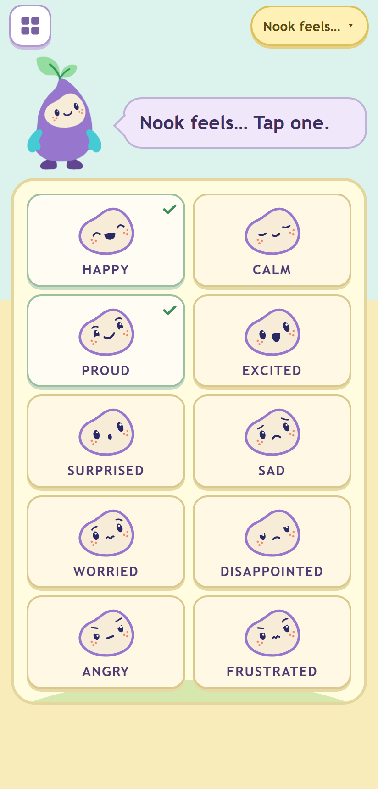
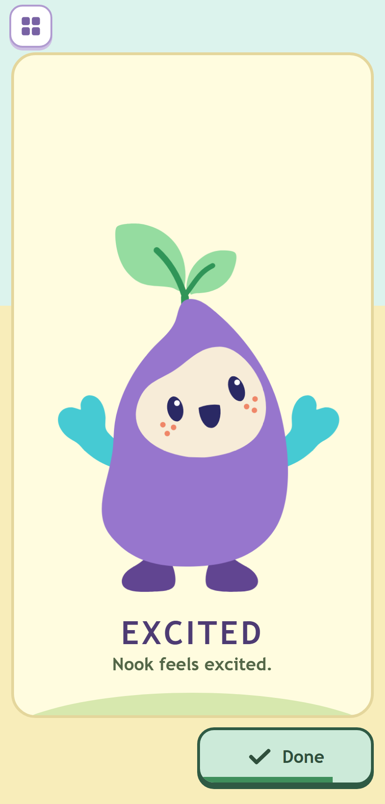
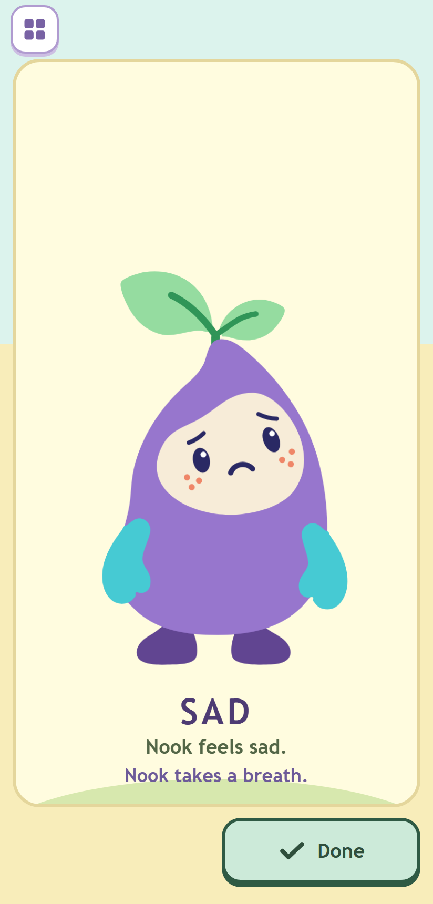
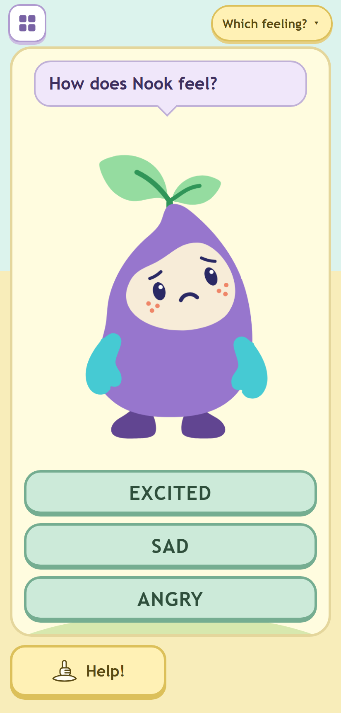
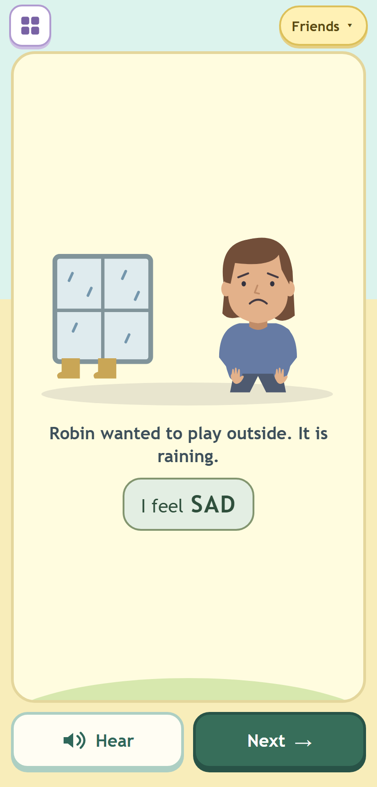
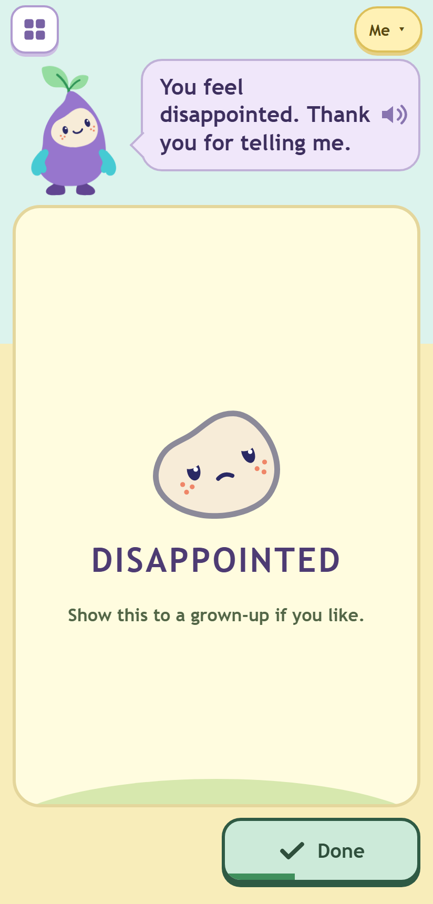

# Phase 4: Feelings with Nook, and Nook's pay-offs in the other games

Round 4, built by Opus 5.5 on 11 October 2026 for Fable's review. Local only: nothing deployed or pushed, no voice
rendered. Evidence is phone (412 x 860) and landscape (915 x 356) only, as asked; the layout harness still checks all
six viewports.

## What was built

| File | Change |
|---|---|
| `feelings.html` | Rewritten as a frame page: shelf button, one pill, Nook with one bubble, the card, the two-slot action bar (Help / Hear / Again on the left, Next / Done on the right). No Back, no sound button, no Menu, no links (garden.html is gone). |
| `feelings.js` | Rewritten: the four activities, the cancellable performance, Which feeling?, Friends, Me, the chooser. `window.LPFeelings` gives tests a read-only view of the performance. |
| `feelings.css` | Rewritten for the frame: boards, the performance and its gestures and breath, Which feeling?, Friends, Me, the chooser; phone, landscape and tablet; Softer and reduced motion. |
| `feelings-data.js` | Additive: `ACTIVITIES`, `ACTIVITY_NAMES`, `BOARD` (order), `DIFFICULT`, `LOOKALIKE`, `LINES`, `nookFeels`, `youFeel`, `ME_REPLIES`, `meLine`, `FEELINGS_SPEECH`, `ME_BUNDLE`, `WHICH_OPENERS`, `whichRound`, `whichSuccess`; `normalise` is version 2 (Match and People saves open Which feeling? and Friends). `spokenBank()` unchanged. |
| `shared.js` | `speak(text, { on: { start, end, fail } })`: start once each clip is actually playing (after `play()` resolves), end after the last clip ends, fail once for muted, missing, hidden or a rejected `play()`. The Blob bundle passes the same hooks and keeps each clip's length. Nothing else changed. |
| `frame.js` | `bubble.say(text, speech, success, player)`: a custom player (Me hears its line from the private bundle); `bubble.prop(html)`. `nook.celebrate(feeling, payoff)` with `{ munch }`, `{ hold }`, `{ beads }`. |
| `nook-art.js` | `NookArt.mouth(svg, feeling)`: swap only the mouth for a moment (the munch). |
| `frame.css`, `garden.css` | The pay-off styles (munch, the held shape, the bead string). |
| `garden.js` | Take away success: happy and a munch instead of the hop. Patterns success: the hop plus the bead string under the bubble. |
| `shapes.js` | Success: excited (both mittens up) and the solved shape hops once beside the raised mitten, instead of Nook's hop. |
| `*.html` | Asset versions bumped to `20261011r4p4`. |
| `tools/test-little-patterns-feelings.cjs` | Rewritten (below). |
| `tools/test-little-patterns-layout.cjs` | 15 Feelings and 3 pay-off scenarios; feeling cards, Me buttons and Say it in the label check; Chrome starts with autoplay allowed so performances run on their real clips; scenarios can take timed `steps`. |
| `tools/test-little-patterns-shapes.cjs` | The success test checks the held shape instead of the hop. |
| `BUILDER-NOTES.md` | The suite command now lists the nook and shapes suites and the layout harness. |

## Nook feels... and the performance (item 56)

Ten cards in one neutral style, in the order happy, calm, proud, excited, surprised, sad, worried, disappointed, angry,
frustrated (happy side first, each look-alike beside its pair). Each card is the `face()` crop (lavender rim) and the
word. The frame Nook rests in `rest`.

A tap starts the sequence, with a generation token; every timer and every speech callback checks it:

1. **Enter.** The word's clip starts from the tap itself (iPad audio permission), the board fades 160 ms, the layout goes
   solo (the frame Nook hides, so only one Nook ever changes) and the big Nook, rendered at full size, grows from the
   frame Nook's place (300 ms, Web Animations, so no `var()` in keyframes for Safari 16).
2. **Perform.** `NookArt.change` behind a blink, then one gesture on the wrapper: happy two 8 px hops, excited three
   10 px hops (1.14 s), calm one slow breath, sad a 6 px sink, worried a 4 px look each way, angry one squash, frustrated
   one huff, surprised a 10 px rise, proud a 4 px lift, disappointed a 5 px slump. All under 1.2 s, at most 12 px and
   scale 1.04; no shake or flash.
3. **Hold** until the last clip has actually ended, plus 600 ms (and not before the gesture has had its 1.2 s).
4. **Settle** (sad, angry, worried, frustrated, disappointed): one breath, 1.2 s in and 1.6 s out from where the
   gesture left Nook, changing to calm on the out-breath; "Nook takes a breath." shows under the line only while it
   happens (and goes to the status region; it is spoken once phase 5 renders it).
5. **Return.** Nook shrinks back to the frame (300 ms), the board fades in, a tick draws on that card (250 ms), and the
   board ignores taps for 300 ms. Nook rests again.

Done is always in the right slot. Its 6 px line follows actual playback: it starts when `play()` has resolved, spans
the clips by their lengths, and is hidden with sound off, before playback, after it and in Softer / reduced motion.
Done stops speech and every pending step; a difficult feeling takes a 600 ms return to calm first. With sound off, a
blocked `play()` or a missing clip, Nook keeps the feeling and waits for Done: there is no countdown. A tap on the big
Nook replays the word and the return waits for that replay to end. A new card (during the fade), the shelf, a player
change, pagehide or a bfcache restore cancel the whole sequence and leave no tick. Hiding the page while Nook speaks
leaves the performance waiting for Done or a tap. Ticks last one visit to the board (reset on entering it, on a player
change and on load); there is no counter; with all ten ticked the bubble says "We said all the feelings." (spoken once
its clip exists), and Nook stays resting: no celebration.





## Which feeling?

Solo layout: the bubble at the top of the card ("How does Nook feel?"), Nook large showing one feeling, three words.
The deck (`whichRound`) deals each feeling once per pass of ten, shuffled by the player's seed and the pass; level 1
takes one other word from the same side and one from the other side, never sad with disappointed or angry with
frustrated; level 2 takes any two (look-alikes included); the answer moves round the three places. Help step 1 puts
Nook's face beside each word, step 2 outlines the answer. A wrong word changes only the bubble (a kind retry line from
its clip); Nook does not react. The right word greens with a tick, the others fade, all lock; Nook changes to proud or
happy (alternating, never the feeling it was showing) with one hop; the bubble says the opener and the word ("You found it!
Excited."), composed from existing clips. Again (small, left) and Next (right) after success; no Next before.



## Friends

The twenty stories exactly as in round 3: the drawn scene, the words, "I feel SAD", the narration on arrival, Hear
(left slot) and Next (right), "Sound is off" when it is. Any story from the chooser.



## Me (item 57)

The child's board: the same ten face crops with a neutral ring (`#8C8A99`), plus Something else and Not sure. A choice
shows the face with the neutral ring, the word and "Show this to a grown-up if you like." (from the mock); the bubble
says "You feel sad. Thank you for telling me."; Nook stays resting throughout (never mirrors, never fixes); Done
returns to the board. Not sure: "That's OK. Not sure is fine." Something else: the question is focused (not the box, so
the keyboard opens only when tapped), the offline device voice reads the guidance and the typed words, then the bubble
says "Thank you for telling me."

Privacy, carried forward: as Feelings opens, before any choice and whatever the activity, ONE fixed Blob bundle of
every name and acknowledgement in the library is fetched (`ME_BUNDLE`, 24 lines; 12 have clips today, so 12 requests,
`credentials: omit`, `no-referrer`). The card, the bubble and a tap on Nook all replay from that bundle (the bubble
gets a custom player), never a library file chosen by the answer; until the acknowledgement clips exist the bare name
plays. Nothing is saved, logged or put in a URL; the report clears on leaving Me, a player change, pagehide and a
bfcache restore (the bundle is disposed on pagehide and fetched again on restore); hiding the page stops the voice and
keeps the card, as before.



## Nook's pay-offs (item 33)

On success only, each under a second, wrapper or face only:

- **Take away**: Nook turns happy and munches: the mouth opens and closes three times (140 ms each, the surprised O
  and back) with a 2 px chew on the wrapper, in place of the hop. Softer / reduced motion: no chewing. Not when
  Nook eats none.
- **Shapes**: Nook turns excited (both mittens up) and a small copy of the solved shape appears beside the raised
  mitten and hops once (8 px), then fades, in 900 ms, in place of Nook's hop. Softer: a fade only.
- **Patterns**: the usual hop, and the finished bead string (up to eight beads) shows just under the bubble for 950 ms.

[payoff-take](phase-4/phone-payoff-take.png), [payoff-shapes](phase-4/phone-payoff-shapes.png),
[payoff-patterns](phase-4/phone-payoff-patterns.png).

## FEELINGS_SPEECH (for phase 5)

`F.FEELINGS_SPEECH`, 27 lines, not in `spokenBank()` yet:

```
Nook feels happy. / sad. / angry. / calm. / worried. / excited. / proud. / surprised. / frustrated. / disappointed.
You feel happy. Thank you for telling me.   (and the same for the other nine feelings)
Nook takes a breath.
Thank you for telling me.
That's OK. Not sure is fine.
How does Nook feel?
How do you feel?
We said all the feelings.
We did it!
```

The code already uses each line once its clip exists: the performance appends "Nook feels {x}." after the word, the
breath and the all-ten line speak, and Me's bundle picks up the acknowledgements (the bundle size grows; the tests
compute it from the library).

## Tests

| Suite | Before | After |
|---|---|---|
| `test-little-patterns.cjs` | 42 | 42 |
| `test-little-patterns-ui.cjs` | 74 | 74 |
| `test-little-patterns-voice.cjs` | 3 | 3 |
| `test-little-patterns-feelings.cjs` | 21 | 32 (29 tests, one with 3 subtests) |
| `test-little-patterns-nook.cjs` | 16 | 16 |
| `test-little-patterns-shapes.cjs` | 22 | 22 |
| **Total** | **178** | **189 pass, 0 fail** |
| `test-little-patterns-layout.cjs` (Chrome) | 6 pass, 45 scenarios | 6 pass, 63 scenarios (45 + 15 Feelings + 3 pay-offs) |

`node tools/stage-little-patterns.cjs --check`: passes, 333 runtime files (no new runtime file).

The old 21 Feelings tests are rewritten with their intents kept: sound on from the start; the art; wrong answers change
only the bubble; the composed praise; Friends teaching every feeling with Hear and Next and the narration; Me's fixed
bundle, no answer-chosen request, nothing saved, one player; late or failed bundles; clearing on navigation, a player
change, pagehide and bfcache; late assets discarded; blocked storage and lowercase; the allow-list restore; the chooser
and mute stopping private playback; focus after the chooser and one live region; Something else with an offline voice
only; remote voices refused and edits cancelling. New: the data (board order, legacy saves, the allow-list), the
FEELINGS_SPEECH list, the Which feeling? deck (level 1 never pairs look-alikes, over five seeds and both levels), the
frame page, the chooser, and with Node's mock timers: the performance holding until the clip has ended, the breath for
difficult feelings only with its caption only during it, sound off / blocked play() / a missing clip requiring Done,
Done cancelling, the replay deferring the return, a new card / the shelf / a player change / pagehide / bfcache
cancelling, the generation token rejecting a late callback, the progress line, ticks per visit and the all-ten line,
Which feeling? Help, wrong and right, Me's neutral ring and resting Nook, the pay-offs not running on wrong answers
(and Softer), and the CSS motion limits.

## Screenshots (`phase-4/`)

24 PNGs, `phone-*` (412 x 860) and `land-*` (915 x 356), taken by the layout harness: `feelings-board` (after two
performances: two ticks), `feelings-perform` (excited, 1.25 s in, the line on Done part-way), `feelings-perform-sad`
(2.5 s in: mid-breath, caption showing), `feelings-which`, `feelings-which-help`, `feelings-which-done`,
`feelings-friends`, `feelings-me`, `feelings-me-chosen`, `payoff-take` (mid-chew), `payoff-patterns`, `payoff-shapes`.
I looked at each; the first round found the big Nook 7 px too wide on the phone, the Done line painting full when the
clip started before Done was on screen, and DISAPPOINTED breaking in the landscape Me bubble, all fixed.

## Judgement calls

1. **Which feeling? success, as specified**: Nook changes to proud or happy. That removes the feeling the child just
   named from view, and a sad Nook turning happy on a right answer could read as "fixing" sad (item 65). The line is
   therefore "You found it! Excited." (opener + word), not "Nook feels sad." The alternative is to keep the feeling
   shown and let only the word green: a one-line change. **Fable to decide.**
2. **Friends is solo** (no frame Nook): the stories are the children's, the narration is theirs, and the scene needs
   the room in landscape. The brief lists only the performance and Which feeling? as solo.
3. **Which feeling? words stack in three rows in portrait** (across in landscape and on tablets): DISAPPOINTED does not
   fit three-across at 360 px above about 10 px type; stacked it is 24 px, and Help's faces sit beside the words.
4. **In Me, a tap on Nook replays Nook's line** (from the bundle) instead of the frame's "Nook feels happy." response,
   so Nook never voices a feeling of its own over the child's report.
5. **The board prompt "Nook feels… Tap one."** (from the mock) has no clip and is not in the FEELINGS_SPEECH list.
6. **The performance's speech starts at the tap**, before the board has faded, so iPad Safari allows it; the gesture
   and expression follow 0.46 s later, within the word.
7. **Excited's three hops are 380 ms each** to stay under 1.2 s; calm's breath is 1.1 s (the table said 2.4 s).
8. **Done on a happy-side feeling returns at once**; on a difficult one it changes to calm and returns after 600 ms,
   without the caption (too short to read).

## Open points

1. Fable: judgement call 1 (Which feeling? success expression).
2. Phase 5: render the 27 lines (plus "Nook feels… Tap one." if wanted). The 12 old "You chose {x}." clips are still in
   the bank but no screen says them now; dropping them is a phase-5 choice.
3. `feelings-content.html` (Grown-ups: "Feelings: every word and story") still describes Match and People; regenerate it
   with `tools/build-little-patterns-feelings.cjs` in phase 6. The old page's Grown-ups text about Me's privacy is no
   longer on the play screen; the Grown-ups privacy sheet could carry one line about Me.
4. Device pass (S24, iPad 5): Web Animations for the grow and shrink, `aspect-ratio` on the big Nook, the speech-from-tap
   timing on Safari 16, and the textarea with the device keyboard in landscape.
5. The old Match activity (the children's pictures) is gone from the UI as the brief replaces it; its data and clips
   stay because `spokenBank()` and the content page use them.

Commit: COMMIT_HASH
