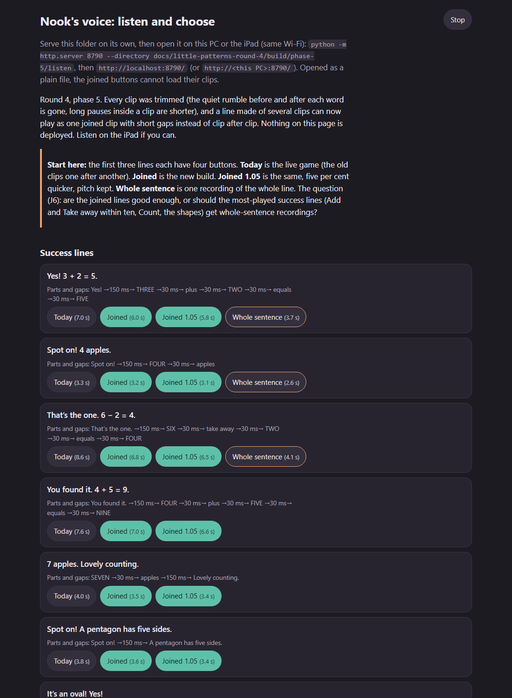

# Round 4, phase 5: voice lines and speech

Built by Opus 5.5 on 11 October 2026 for Fable's review. Local only: nothing deployed or pushed.

## What Jof should listen to first

```
python -m http.server 8790 --directory docs/little-patterns-round-4/build/phase-5/listen
```

Open `http://localhost:8790/` (or `http://<this PC>:8790/` on the iPad, same Wi-Fi). The first three rows answer J6:
**Today** (the live game's chain), **Joined**, **Joined 1.05** and **Whole sentence**. My honest read of the numbers:
joining and trimming help, but the Gemini grandfather says each single word slowly and with its own full intonation,
so a joined Add line stays long. "Yes! Three plus two equals five." is 7.0 s today, 6.0 s joined, 3.7 s as one
recording. If Jof's ear agrees, the fix for the most-played lines is whole-sentence clips (item 22), not more joining.



## A. The frozen list

`phase-5/new-lines.csv`: 76 new clips, 3 comparison recordings, 12 dropped lines, each with its key, the exact text
sent, the game and use, and the style note. The 76 new clips:

- Shapes, 15: `SHAPES_SPEECH` (7 "It's a/an {shape}!", 5 "A {shape} has {n} sides.", 3 prompts).
- Feelings, 28: `FEELINGS_SPEECH` (27) plus the board prompt "Nook feels… Tap one."
- Garden and the shelf, 33: 18 prompts, 10 Help lines, and 5 phrases for the composed prompts ("then", "more.",
  "How many?", "Nook eats", "How many are left?"). `learning.js` gains `PROMPT_SPEECH` and `sumPrompt(round)`:
  "Three, then two more. How many?" is said as `three,` `then` `two` `more.` `How many?` with the number clips;
  "Nook eats two. How many are left?" likewise; "none" and "them all" are whole lines. Bubble text is unchanged
  (tested over every Add and Take away round). `garden.js` now gives every prompt its clip key, so the speaker shows.
- Dropped: the 12 "You chose {x}." clips. Not rendered: the four bare shape names (nothing says them) and "Type your
  words. Then tap the speaker." (Me's Something else stays on the device voice).

Style notes in `LINE_STYLE`: start on the first word, no laugh/ho-ho/oh; "say an oval"; Nook rhymes with book; the
fragments say only their word, level and continuing. The new lines are sent with the game's own punctuation, so
questions stay questions (old lines unchanged, so their cached takes stay valid).

**Caught before spending:** `library voice_l1goo4gqobvj` pointed at an empty raw cache (the takes live under
`gemini-raw/northampton`) and would have re-rendered all 233 old lines. The tool now maps the voice id to its design.

## B. Render

`library voice_l1goo4gqobvj`: 76 requests (two HTTP 429 waits, retried), $0.052 by audio produced ($0.045 estimated).
`compare voice_l1goo4gqobvj`: 3 requests, $0.003. **79 requests, about $0.055.** No split needed, so there is no pending
list and no `tools/little-patterns-voice-pending.json`. Library: 259 clips before, **323** after (33.4 MiB after trimming).
The comparison recordings live in `phase-5/listen/compare/` only (the voice test checks they are not game clips).

Mechanical check of the new clips: all bounded, non-silent, unclipped (voice test); no word over 2.5 s, no sentence
over 7 s. **Outliers for Jof's ear:** "more" 1.31 s and "then" 0.93 s (both breathe out to the end of the take), the
ten "Nook feels {x}." lines at 2.1 to 3.1 s for three words (the calm note made them deliberate), "Drag the words, first
to last." 4.2 s, "Nook eats them all. How many are left?" 5.0 s.

## C. Trim and pause compression (`tools/nook-voice-polish.py`)

Rules (details in the tool): what counts as speech is measured per 5 ms against the clip's own peaks, on the plain
level (35 dB) and on a pre-emphasised copy (48 dB). The model leaves a low rumble, a click and often a breath before
and after the words; the rumble has no high frequencies while quiet consonants do, so the f of FIVE and the s of SIX
stay and the rumble goes. 30 ms lead, 50 ms tail, 10 ms fades. Short bursts more than 150 ms from the words are clicks
and are left out, unless the line ends on a stop consonant. An audit follows quieter voice 6 dB further down (above the
clip's own floor); when it runs more than 20 ms past a cut, that end is cut again at the lower level (17 clips, e.g.
"ali is calm" would have lost 175 ms of its m). Pauses over 250 ms that stay quiet their whole length become 150 ms,
except a clip's sentence breaks, which keep 300 ms (item 66: phrase boundaries get different treatment; one constant).
Phonics: untouched. A ledger makes reruns no-ops; the library run undoes the trim, so the voice test fails until the
polish is run again.

| | |
|---|---|
| Clips trimmed | 297 (all but the 26 phonics sounds) |
| Removed | 128.4 s of 838.5 s: 70.8 s at the ends, 57.5 s of pauses (122 clips had one) |
| Median cut | 50 ms at the start, 93 ms at the end |
| Longest end trim | 612 ms, "Tap each side." |
| Longest start trim | 400 ms, "A fish can swim." |
| Clicks left out | 47 clips (4 after the words: three "calm" clips and "sixteen") |

Audition (`python tools/nook-voice-polish.py --audition`; "quiet end" is where the audit hears the last of the voice):

| clip | before | after | last speech | quiet end | cut at |
|---|---|---|---|---|---|
| five | 1.149 | 1.085 | 1035 ms | 1050 ms | 1085 ms |
| six | 1.256 | 1.025 | 1115 | 1115 | 1165 |
| apples | 1.128 | 1.055 | 1005 | 1015 | 1055 |
| the pattern fits | 2.329 | 2.065 | 2210 | 2215 | 2260 |
| a hexagon has six sides | 2.651 | 2.375 | 2530 | 2535 | 2580 |
| nook takes a breath | 2.487 | 1.965 | 2340 | 2375 | 2390 |
| equals | 1.687 | 1.285 | 1505 | 1510 | 1555 |

Every cut is at or after the quiet end. All per-clip figures: `phase-5/trim-stats.json`. The listening page has
before/after buttons for these and for the greeting and a story.

## D. Joined speech (`shared.js`)

`shared.js` now starts with `LPVoiceJoin` (pure, `require`-able in Node): `parseWav` (24 kHz 16-bit mono PCM only,
else null), `phraseGaps`, `joinPcm`, `encodeWav`, `join`. Gaps: 150 ms after a part ending in . ! ? , or …, or before
a part that starts a sentence (a closing "Spot on!"); 30 ms between the words of a phrase. Each clip keeps its own
30/50 ms pads, so words in a phrase sit about 110 ms apart.

`speak([several clips])`: once a clip has played from a tap and the player is a real media element, the parts are
fetched (bundled paths only, same-origin, `credentials: 'omit'`, no player data), joined, and played as one WAV Blob
through the same player; parts already in memory (LRU of 40) join and play at once, inside the tap. Single clips, the
first line of a visit, the private Me bundle, jsdom, and any failure (fetch, format, playback) use the old chain.
`on.start(i, n, clip)` still reports each part as it starts (timers from the join offsets), so the Feelings Done line
is unchanged. `LP.audio.rate` 1 to 1.05 (default 1) with `preservesPitch`; `LP.audio.join` 'auto' / true / false.
Checked in real Chrome: one Blob of 6.04 s for the Add line, rate and pitch applied, the repeat built from memory.

## E. Listening page

`phase-5/listen/` (static, local only, built by `tools/build-little-patterns-listen.py`): nine success lines (three
with whole-sentence recordings), five prompts, the ten "Nook feels" performances (word + line), and nineteen
before/after clips. It joins in the browser with a copy of the game's own `shared.js`, so on the iPad it also tries
the real Blob path. 8.3 MiB with its clips.

## F. Tests

| Suite | Before | After |
|---|---|---|
| `test-little-patterns.cjs` | 42 | 42 |
| `test-little-patterns-ui.cjs` | 74 | 78 (join, fallback, rate, every Garden prompt voiced) |
| `test-little-patterns-voice.cjs` | 3 | 6 (the joiner, the composed prompts, the polish ran) |
| `test-little-patterns-feelings.cjs` | 32 | 33 (prompts voiced) |
| `test-little-patterns-nook.cjs` | 16 | 16 |
| `test-little-patterns-shapes.cjs` | 22 | 22 |
| `test-little-patterns-layout.cjs` | 6 | 7 (joined speech in real Chrome) |

All green; `stage --check` passes (397 files). Rewritten to the new state, same intent: the performance now waits
for "Nook feels {x}." after the word; shape facts and prompts are voiced; the bubble's "no clip, no speaker" case
uses a removed clip. The four frame pages' cache key is now `?v=20261011r4p5`.

## Open points

1. **J6** (above): whole-sentence clips for Add and Take within ten and Count, or keep joining. Levels 1 and 2 of Add
   and Take away have 92 distinct sums; said as the fact alone ("Three plus two equals five.") and joined to the
   opener with the 150 ms phrase gap, that is about 92 requests, one day at the cap, plus about 20 for Count. The shape
   facts are already whole sentences.
2. **iPad Safari**: the joined Blob after a fetch is untested on the device (the player is unlocked by then; any error
   falls back to the chain). The listening page exercises the same path.
3. "more" and "then" end in an out-breath, which makes the composed Add prompt 5.3 s; re-render both, or drop the
   composed prompt's voice, if Jof dislikes it (2 requests).
4. Sentence breaks keep 300 ms rather than 150 ms; the join gaps sit on top of the clip pads. Both are one constant.
5. "We did it!" is rendered but no screen says it yet (phase 3's judgement 9).
6. `docs/nook-voice-recordings.csv` was already out of date (255 rows); `new-lines.csv` is round 4's record.

Commit: see the next line.
